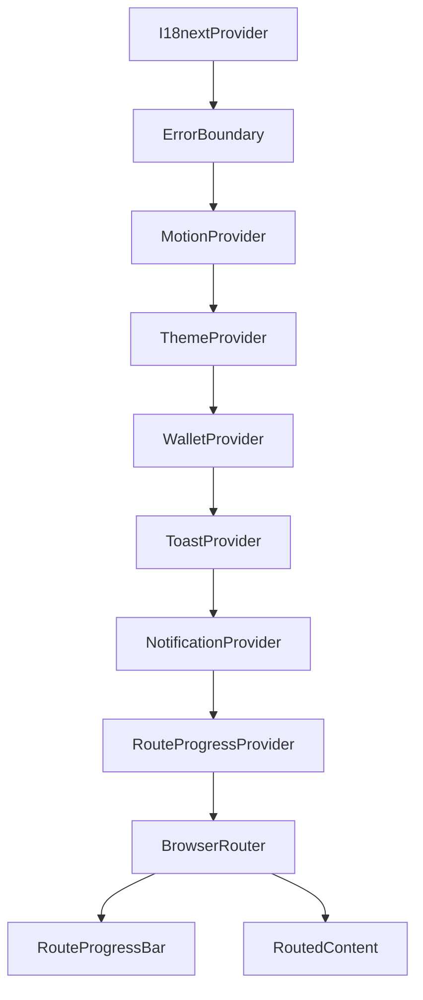

# Frontend Architecture & Component Conventions

This document defines the folder structure, naming rules, state management
patterns, and conventions for the ai-net frontend.

---

## Folder Structure

```
frontend/src/
├── components/          # Reusable UI components
│   ├── common/          # Generic, domain-agnostic (Toast, Skeleton, ErrorBoundary, MotionProvider)
│   ├── ui/skeleton/     # Skeleton kit entrypoint (re-exports + SkeletonChart)
│   ├── layout/          # App shell, navigation, sidebar
│   ├── landing/         # Public landing page components
│   ├── dashboard/       # Dashboard widgets (KPI cards, tables, charts)
│   ├── tasks/           # Task-related UI (filter, timeline, comparison)
│   ├── notifications/   # Notification center and items
│   └── wallet/          # Wallet wizard, transaction table, charts
├── context/             # React Context providers (Wallet, Theme, Toast, Notifications)
├── hooks/               # Custom React hooks (useWallet, useTheme, useTaskWebSocket, etc.)
├── i18n/                # Internationalization config and locale JSON files
│   └── locales/         # en.json, zh.json, etc.
├── mocks/               # MSW mock handlers for development/testing
├── pages/               # Route-level page components
│   └── tasks/           # Task sub-pages (NewTaskPage, TaskHistoryPage)
├── schemas/             # Zod validation schemas (wallet, task)
├── types/               # TypeScript type definitions (agent, api, notification)
└── utils/               # Pure utility functions (format, time, agentRegistry)
```

---

## Naming Rules

### Files

| Kind       | Pattern                       | Example                               |
| ---------- | ----------------------------- | ------------------------------------- |
| Component  | `PascalCase.tsx`              | `AgentCard.tsx`, `TaskFilterBar.tsx`  |
| CSS Module | `PascalCase.module.css`       | `AgentCard.module.css`                |
| Plain CSS  | `PascalCase.css`              | `Toast.css`                           |
| Hook       | `camelCase.ts` (prefix `use`) | `useWallet.ts`, `useTaskWebSocket.ts` |
| Type       | `camelCase.ts`                | `agent.ts`, `api.ts`                  |
| Schema     | `camelCase.ts`                | `wallet.ts`, `task.ts`                |
| Utility    | `camelCase.ts`                | `format.ts`, `time.ts`                |
| Test       | `*.test.ts` / `*.test.tsx`    | `useNodeState.test.ts`                |
| i18n test  | `*.i18n.test.tsx`             | `RecentTasksTable.i18n.test.tsx`      |

### Components

- **One component per file.** File name matches the default export.
- **Named exports** for types/interfaces (`AgentData`, `AgentCardProps`).
- **No default export for hooks or utilities** — use named exports.
- **Co-locate tests** next to the component: `AgentCard.tsx` → `AgentCard.test.tsx`.

### CSS

- **CSS Modules** for component-scoped styles (`.module.css`).
- **Plain CSS** only for global resets or third-party overrides.
- Use Tailwind utility classes inline when possible; CSS Modules for complex
  animations or pseudo-elements.

---

## State Management

### Provider hierarchy

`App.tsx` mounts these providers once. The router sits inside them, so a route change preserves the wallet session, theme, and notification feed.



| Provider | State and responsibility |
| --- | --- |
| `I18nextProvider` and `MotionProvider` | Supply translations and apply the user's reduced-motion preference to animations. |
| `ThemeProvider` | Stores the selected theme locally and resolves system mode against the OS preference. Components read it through `useTheme()`. |
| `WalletProvider` | Restores the wallet session, tracks the active network and exposes connection and signing readiness through `useWallet()`. |
| `ToastProvider` | Holds the queue of transient messages and handles dismissal. |
| `NotificationProvider` | Receives WebSocket events and persists the notification feed in local storage. `useNotifications()` reads and updates that shared feed. |
| `RouteProgressProvider` | Tracks in-flight activity and exposes progress and errors to the route progress bar. |

### From the API to the page

On the task history page, changing a filter updates the URL search parameters. `TaskHistoryPage` passes the filters to `useTaskHistory`. The hook reads the wallet public key and calls `apiClient.get` on `/api/wallets/{address}/tasks` with the page size, status, and optional cursor. It merges subsequent pages by task ID and exposes the filtered rows, loading state, pagination, and errors to the page. A disconnected wallet produces an empty list. [Page](../frontend/src/pages/tasks/TaskHistoryPage.tsx) · [Hook](../frontend/src/hooks/useTaskHistory.ts)

| Feature hook | State it owns |
| --- | --- |
| `useAgentRegistry` | Agent results, filters, polling, and cursor navigation. |
| `useTaskSubmit` | Task submission progress and errors. |
| `useTaskWebSocket` | Per-task connection and reconnection state. |
| `useWalletBalance` and `useNetworkStats` | Balance and network metrics for the consuming view. |

### Choosing where state lives

Keep a dialog's open flag in the component that displays it. Lift it to the nearest common parent if two siblings need to coordinate. Keep shareable filters in the URL so a deep link can reproduce the view. Use a feature hook for requests, retries, pagination, or subscriptions that belong to one screen. For example, `useAgentRegistry` fetches and filters the agent list, and `useTaskWebSocket` manages a task subscription. Each hook invocation owns its local state. Use a provider when consumers across routes need the same value or lifecycle, as with the active wallet.

---

## Adding New Components

1. Create `ComponentName.tsx` in the appropriate `components/<category>/` folder.
2. Create `ComponentName.module.css` if custom styles are needed.
3. Create `ComponentName.test.tsx` for unit tests.
4. Export the component as default from the file.
5. Use the `PascalCase` naming convention.

## Adding New Pages

1. Create `PageName.tsx` in `pages/` (or `pages/<section>/` for sub-pages).
2. Create `PageName.module.css` if needed.
3. Add the route in `App.tsx`.
4. Add i18n keys in `i18n/locales/en.json` (and other locales).

## Adding New Hooks

1. Create `useHookName.ts` in `hooks/`.
2. Create `useHookName.test.ts` for unit tests.
3. Export as a named export.
4. Prefix with `use`.

---

## Skeleton kit (#719)

Import placeholders from a single entrypoint — never hand-roll
`animate-pulse` skeleton markup in pages:

```tsx
import { Skeleton, SkeletonText, SkeletonCard, SkeletonTable, SkeletonChart } from '../../components/ui/skeleton';
```

| Primitive | Use for |
|---|---|
| `Skeleton` (`text`/`pill`/`circle`/`rect`/`card`) | Single line, chip, avatar dot, block |
| `SkeletonText` | Paragraph (configurable `lines`, shorter last line) |
| `SkeletonCard` | Framed panel wrapper |
| `SkeletonTable` | Table (`rows` × `columns`, `rowTestId` for tests) |
| `SkeletonChart` | Bar-chart area (deterministic heights, snapshot-stable) |

The shimmer is decorative and disabled under
`prefers-reduced-motion` (`Skeleton.module.css`); the placeholder shape stays.
`TaskDetailPage`, `NewTaskPage` (DAG preview), `dashboard`, `TaskHistoryPage`,
and `WalletPage` all compose this kit. The only remaining `animate-pulse` /
`animate-spin` uses are live status indicators (hero badge, running timeline
node), which freeze under reduced motion via `styles/global.css`.

---

## Verification

Before submitting changes:

```bash
cd frontend
npm run lint
npm run build
```

Lint catches naming violations (unused imports, type issues). Build verifies
the full bundle compiles without errors.

## Bundle-size budgets

The production build emits a manifest and `npm run size` reports the gzip size
of every JavaScript route/vendor chunk. Budgets live in
`frontend/size-budget.json`; the default is 150,000 gzip bytes per chunk.
The frontend CI job runs this check after `npm run build` and fails when a
chunk exceeds its budget. To update a budget intentionally, build locally,
review the reported dependency and route change, then update the JSON with the
measured gzip size plus a small documented margin.
