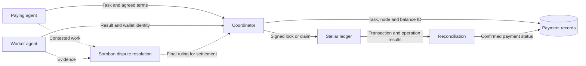

# Threat Model — ai-net

**Last updated:** 2026-11-24

**Scope:** smart-contracts (coordinator, payment, registry), backend services, frontend

---

## 1. Trust Boundaries

| Boundary | Trust Level | Notes |
|----------|-------------|-------|
| **User Browser** → Backend API | Low | All input untrusted; validate + sanitize |
| **Backend API** → Stellar Horizon | Medium | Requires valid keypair; Horizon may be slow/malicious |
| **Backend API** → Agent HTTP endpoints | Low | Agents are external; responses may be malformed or hostile |
| **Coordinator** → Payment Service | High | Internal; same process, but follows defense-in-depth |
| **Coordinator** → DB (SQLite) | High | Local file; WAL mode; no network access |
| **Registry** → Agent Registration | Low | Anyone can register; reputation gated by coordinator |
| **Frontend** → Backend API | Low | Wallet-signed requests; CSRF via SameSite cookies |

---

## 2. Access-Control Matrix

| Component | Can Sign Tx | Can Claim Balance | Can Read DB | Can Write DB | Can Deregister Agents |
|-----------|-------------|-------------------|-------------|--------------|----------------------|
| Coordinator | Yes (keypair) | Yes (see payment paths below) | Yes | Yes | Yes |
| Agent | Own wallet only | If named as a claimant | No | No | No |
| User/Browser | No (wallet signs) | No | No | No | No |
| Payment Service | Yes (via coordinator) | Yes (via coordinator) | Yes (payment DB) | Yes (payment DB) | No |

---

## 3. Reentrancy & Replay Notes

### 3.1 Stellar Claimable Balances

The following controls describe the standalone payment helper. Section 3.4 covers the backend service as well.

- **Reentrancy risk:** LOW. `releasePayment` atomically claims + pays in a single Stellar transaction. No intermediate state is observable.
- **Replay protection:** Stellar transactions include `sequence` numbers. Each tx is unique. The `setTimeout(180)` envelope prevents stale tx submission.
- **Double-release protection:** `EscrowAlreadySettledError` thrown if balance already claimed. Horizon returns 404 for non-existent balances.

### 3.2 Task Execution
- **DAG execution:** Each node runs once. Topological sort ensures dependency ordering. `handleAgentFailure` retries with fallback agents (max 3 per agent, tries all registered).
- **Concurrent task execution:** `ConcurrencyLimiter` caps parallel nodes (default 3). No shared mutable state between concurrent node executions.

### 3.3 Coordinator Dispatch
- **Replay:** HTTP requests to agents include `X-Correlation-ID` for tracing. Agent idempotency is the agent's responsibility.
- **Timeout handling:** `AbortController` enforces `timeoutMs`. Aborted requests throw `RetryableAgentError`.

### 3.4 Agent-to-agent payment flow

A paying agent requests work from a worker agent. The coordinator links their off-chain task to an on-chain balance. The task database records intent and progress. The ledger determines whether the balance was consumed and which account received the funds.

**Wallet and ledger boundary.** Validate the paying identity, worker destination, asset and amount against the authorized task before signing. The standalone helper names the coordinator as sole claimant and combines the claim and payment to the agent in one transaction. The backend service names both the coordinator and agent as unconditional claimants. Its release operation claims the balance as the coordinator. For that path, confirm the actual destination on the ledger before treating the local `released` status as proof of payment to the worker. [Standalone helper](../smart-contracts/src/payment/payment.ts) · [Backend payment service](../backend/src/payment/payment.ts)

| Threat | Control and verification |
| --- | --- |
| Double spending or duplicate funding | Stellar consumes a claimable balance once. Track the original balance ID alongside the task and node IDs. After a timeout, reconcile the original transaction before authorizing another lock. Two separately funded balances are separate obligations. |
| Front-running or conflicting claims | In a bidding market, use the contract's sealed commit/reveal phases. Commitments bind the bid to its contract, task and bidder. At settlement, check the claimant policy against the agreement. If payment depends on work approval, use an escrow that enforces that condition on-chain. An unconditional claimant can claim before approval. [Bidding contract](../smart-contracts/contracts/agent_bidding/src/lib.rs) |
| Replayed transaction or task instruction | Signed Stellar envelopes bind the network, source sequence and time bounds. At the application boundary, use a durable task/node identifier and the original balance ID and transaction hash to recognize retries. Confirm a prior submission's result before signing a replacement. A trace ID is for correlation. |

**Dispute boundary.** For a contested task, preserve its agreed terms, evidence references, balance ID and transaction hashes. The dispute contract accepts evidence and authorized votes. Its first ruling opens an appeal window. Settlement logic should wait for a final ruling, then reconcile the resulting ledger operations. A ruling cannot reverse an already-confirmed Stellar claim. [Dispute contract](../smart-contracts/contracts/dispute_resolution/src/lib.rs)

---

## 4. Storage-Rent Risks (Soroban Migration)

| Data | Current | Soroban Risk | Mitigation |
|------|---------|--------------|------------|
| Task metadata | In-memory / DB | High — Soroban charges rent for storage | TTL-based expiry (`ttlDays`); `store_task_metadata` accepts TTL |
| Agent registry | In-memory with TTL | Medium — agents re-register periodically | 30s TTL cache; expired entries pruned |
| Payment records | SQLite | N/A (off-chain) | Already off-chain; on-chain is Stellar claimable balances |
| Execution traces | Filesystem (`logs/tasks/`) | N/A | Cron cleanup; not on-chain |

**Known limitation:** In-memory registry is ephemeral. On crash, all registrations lost. Soroban migration will fix this.

---

## 5. Known Limitations

1. **In-memory registry** — Lost on restart. Agents must re-register. No persistence across process restarts.
2. **Coordinator keypair in env** — `STELLAR_SECRET_KEY` in environment variables. If compromised, full escrow control. Mitigation: use a signing service / HSM in production.
3. **Memo.text 28-byte limit** — Task IDs longer than 28 bytes (UTF-8) cannot be used as Stellar memos. `lockEscrow` enforces this.
4. **1e-7 precision bug** — `xlmToStroops(1e-7)` throws because JS renders small numbers in scientific notation. Only affects bare `number` inputs; string `'0.0000001'` works.
5. **Retry cap** — `handleAgentFailure` retries up to 3 times per agent. If all agents for a type are exhausted, the node fails permanently. No infinite retry.
6. **Horizon dependency** — Payment operations depend on Stellar Horizon availability. Exponential backoff retries on 429/504, but prolonged outages will cascade.

---

## 6. Audit Slots

Each contract/module has a designated audit focus area:

| Module | Audit Focus | Key Questions |
|--------|-------------|---------------|
| **Coordinator** | DAG execution correctness | Is topological sort correct? Can failure cascade be exploited? |
| **Payment** | Escrow atomicity | Can double-claim occur? Are refund/release race conditions safe? |
| **Registry** | Access control | Can unregistered agents be assigned tasks? Is reputation manipulation possible? |
| **Backend API** | Input validation | Are all endpoints schema-validated? Is rate limiting enforced? |
| **Frontend** | XSS / wallet security | Are secret keys handled safely? Is CSP configured? |

---

## 7. Release Gating

**Before tagging a release:**
1. All items in `SECURITY_CHECKLIST.md` must be checked.
2. No CRITICAL or HIGH security findings from the checklist are open.
3. Fault injection tests pass in CI.
4. Reconciliation job detects drift within 5 minutes.
5. i18n parity test confirms en/zh key equality.
6. Automated controls (`security-audit`, `secret-scan`, `container-scan`,
   CodeQL — see *Automated Controls* in `SECURITY_CHECKLIST.md`) are green
   for the release commit, and the manual Soroban invariants (M1–M12) have
   been signed off by a second reviewer.

---

## Appendix: Contract-Level Audit Checklist

- [ ] Coordinator: `CyclicDAGError` thrown for circular deps
- [ ] Coordinator: `handleAgentFailure` retries correctly across agents
- [ ] Coordinator: `MAX_RETRIES` enforced per agent
- [ ] Payment: `lockEscrow` memo size validated
- [ ] Payment: `releasePayment` atomic claim+pay
- [ ] Payment: `refundEscrow` idempotent (returns same tx or throws)
- [ ] Payment: `getEscrowBalance` returns 0 for settled balances
- [ ] Registry: `clearRegistry` isolates tests
- [ ] Registry: Composite index sorted correctly
- [ ] Registry: TTL expiry removes stale agents
