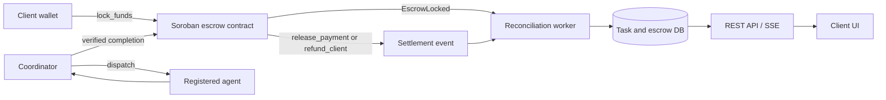
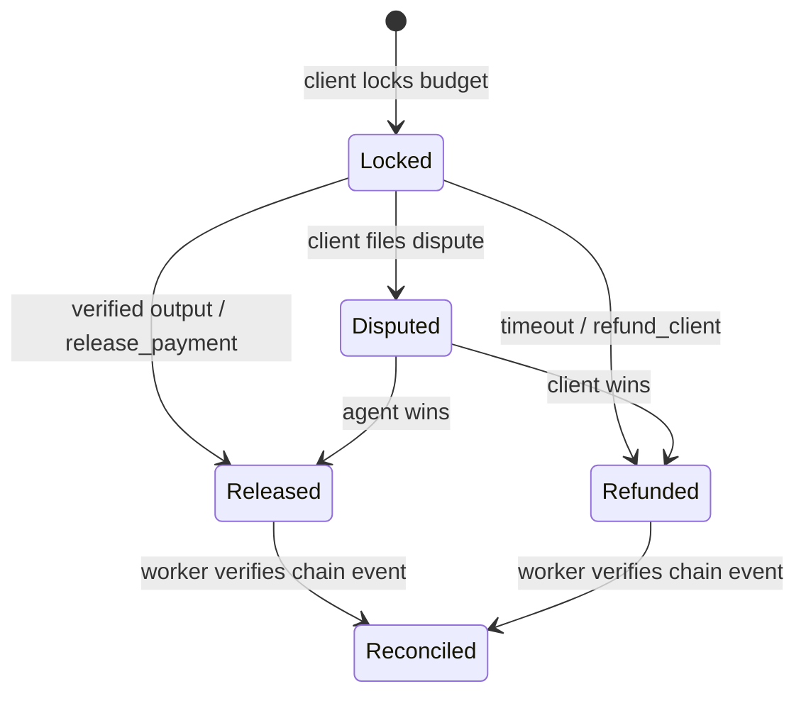

# Payment escrow lifecycle — architecture diagram

This diagram is the quick architectural view of a task payment. The escrow
contract is the source of truth for funds; the coordinator and API only mirror
verified chain events for user-facing status and dispatch.

## Lifecycle states

### Responsibilities and trust boundaries

| Component             | Responsibility                                                   | Must not be trusted for                                |
| --------------------- | ---------------------------------------------------------------- | ------------------------------------------------------ |
| Client wallet         | Signs the funding transaction                                    | Declaring that funds are locked without a chain result |
| Escrow contract       | Holds funds and enforces release/refund/dispute guards           | Off-chain task metadata                                |
| Coordinator           | Dispatches work and requests settlement after verification       | Moving funds without contract authorization            |
| Reconciliation worker | Confirms transaction status and repairs an interrupted DB update | Inventing a settlement event                           |
| API/UI                | Presents task and payment state                                  | Treating a local status as proof of payment            |

For the detailed state matrix, auction flow, dispute flow, and reconciliation
runbook, see [Payment Flows & Escrow Lifecycle](payment-escrow-lifecycle.md).
